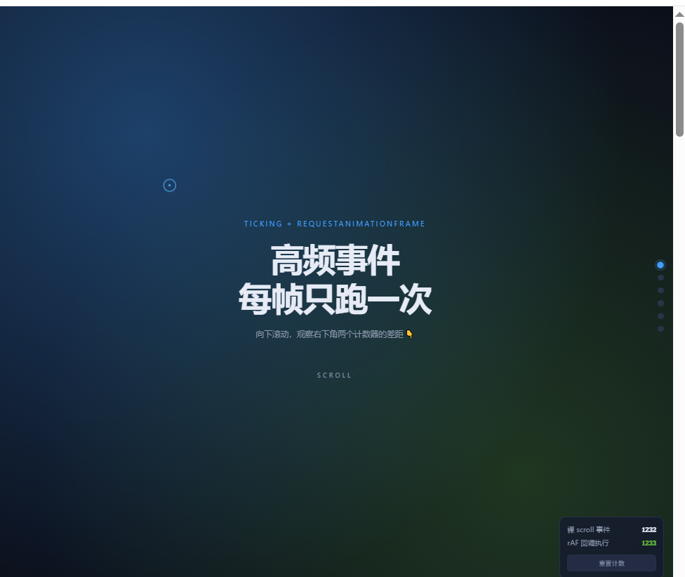
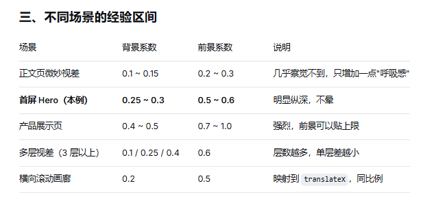

# 视差滚动：核心思路与最小实现

> 视差滚动的全部秘密：**让不同层以不同速度移动，并且只改 transform。**

---



## 一、核心思路（一句话）

> **位移 = 滚动距离 × 系数。**

同一段滚动距离，背景乘 0.28，前景乘 0.55。系数不同，速度就不同，纵深就出来了。

背景移动 28px ← 滚动 100px → 前景移动 55px


前景动得快 = 离镜头近；背景动得慢 = 离镜头远。就这么简单。

---

## 二、三层结构

视差必须先有"层"。DOM 上至少两层，CSS 上必须是**绝对定位 + 相对容器**：

```html
<header class="hero">
  <div class="hero-bg"></div>     <!-- 远层，慢 -->
  <div class="hero-inner">        <!-- 近层，快 -->
    <h1>标题</h1>
  </div>
</header>

```

```css
.hero {
  position: relative;
  height: 100vh;
  overflow: hidden;               /* 裁掉溢出，防止撑破布局 */
}
.hero-bg, .hero-inner {
  position: absolute;
  inset: 0;
  will-change: transform;         /* 提前建图层，避免首帧卡顿 */
}
.hero-bg {
  inset: -30%;                    /* 比容器大，留出移动余量 */
}
```
两个关键点：

overflow: hidden 必须有，否则移动出去的元素会撑出滚动条。

背景要溢出（inset: -30%），否则移动时会露底。溢出量 ≈ 系数 × 最大位移


## 三、核心代码（10 行）

```js
const heroBg    = document.querySelector('.hero-bg');
const heroInner = document.querySelector('.hero-inner');

let ticking = false;

window.addEventListener('scroll', () => {
  if (ticking) return;              // 本帧已排队，丢弃
  ticking = true;
  requestAnimationFrame(() => {
    ticking = false;                // 先解锁，再干活

    const y = window.scrollY;

    heroBg.style.transform    = `translate3d(0, ${y * 0.28}px, 0)`;
    heroInner.style.transform = `translate3d(0, ${y * 0.55}px, 0)`;
  });
}, { passive: true });

```




## 四、执行流程
```
核心执行流程
用户滚动页面
│
├─ scroll 事件触发（可能每秒上百次）
│
├─ if (ticking) return ← 本帧已排队，直接丢弃
│
├─ ticking = true，请求下一帧
│
▼
浏览器 vsync 到来，执行 rAF 回调
│
├─ ticking = false ← 先解锁，再干活
│
├─ 读 scrollY（读阶段集中）
│
├─ 边界判断：Hero 走远就 return
│
├─ 写 transform / opacity（写阶段集中）
│
▼
GPU 合成，屏幕显示
```

## 最小DEMO
```html
<!DOCTYPE html>
<html lang="zh-CN">
<head>
<meta charset="UTF-8">
<meta name="viewport" content="width=device-width, initial-scale=1.0">
<style>
  * { box-sizing: border-box; margin: 0; }
  body { background: #0b0f1a; color: #fff; font-family: system-ui, sans-serif; }

  .hero {
    position: relative;
    height: 100vh;
    overflow: hidden;
    display: grid;
    place-items: center;
  }
  .hero-bg {
    position: absolute;
    inset: -30%;
    background:
      radial-gradient(circle at 30% 30%, rgba(64,158,255,.35), transparent 55%),
      radial-gradient(circle at 70% 72%, rgba(103,194,58,.22), transparent 55%);
    will-change: transform;
  }
  .hero-inner {
    position: relative;
    text-align: center;
    will-change: transform, opacity;
  }
  h1 { font-size: clamp(28px, 6vw, 56px); line-height: 1.2; }
  p  { color: #8b97ad; margin-top: 16px; }
  .spacer { height: 200vh; padding: 80px 24px; color: #8b97ad; }
</style>
</head>
<body>

<header class="hero">
  <div class="hero-bg"></div>
  <div class="hero-inner">
    <h1>视差滚动</h1>
    <p>向下滚动，观察前后景的速度差</p>
  </div>
</header>

<div class="spacer">
  <p>继续向下滚，Hero 已经离开视口，视差逻辑自动停止计算。</p>
</div>

<script>
  const heroBg    = document.querySelector('.hero-bg');
  const heroInner = document.querySelector('.hero-inner');

  let ticking = false;

  window.addEventListener('scroll', () => {
    if (ticking) return;
    ticking = true;

    requestAnimationFrame(() => {
      ticking = false;

      const y  = window.scrollY;
      const vh = window.innerHeight;

      if (y > vh * 2) return;   // 边界：Hero 走远就停

      heroBg.style.transform    = `translate3d(0, ${y * 0.28}px, 0)`;
      heroInner.style.transform = `translate3d(0, ${y * 0.55}px, 0)`;
      heroInner.style.opacity   = String(Math.max(0, 1 - y / (vh * 0.55)));
    });
  }, { passive: true });
</script>

</body>
</html>
```

## 完整DEMO
```html
<!DOCTYPE html>
<html lang="zh-CN">
<head>
<meta charset="UTF-8">
<meta name="viewport" content="width=device-width, initial-scale=1.0">
<title>ticking + requestAnimationFrame · 高频 UI 效果合集</title>
<style>
  :root {
    --bg: #0b0f1a;
    --card: #151c2c;
    --line: #253049;
    --txt: #e6ebf5;
    --sub: #8b97ad;
    --blue: #409eff;
    --green: #67c23a;
  }
  * { box-sizing: border-box; }
  html { scroll-behavior: smooth; }
  body {
    margin: 0;
    background: var(--bg);
    color: var(--txt);
    font-family: -apple-system, BlinkMacSystemFont, "PingFang SC", "Microsoft YaHei", sans-serif;
    -webkit-font-smoothing: antialiased;
    overflow-x: hidden;
  }

  /* ============ 顶部滚动进度条（transform: scaleX） ============ */
  .progress {
    position: fixed; top: 0; left: 0; right: 0; height: 3px;
    background: linear-gradient(90deg, var(--blue), var(--green));
    transform: scaleX(0);
    transform-origin: 0 50%;
    will-change: transform;
    z-index: 100;
  }

  /* ============ 右侧 Scrollspy 导航 ============ */
  .side-nav {
    position: fixed; right: 16px; top: 50%; transform: translateY(-50%);
    display: flex; flex-direction: column; gap: 12px; z-index: 90;
  }
  .side-nav a {
    display: block; width: 10px; height: 10px; border-radius: 50%;
    background: #2a3448; transition: .25s; text-indent: -999em; overflow: hidden;
  }
  .side-nav a.active {
    background: var(--blue);
    box-shadow: 0 0 0 4px rgba(64,158,255,.15);
    transform: scale(1.15);
  }

  /* ============ Hero 视差 ============ */
  .hero {
    position: relative;
    min-height: 100vh;
    display: grid;
    place-items: center;
    overflow: hidden;
  }
  .hero-bg {
    position: absolute;
    inset: -20%;
    background:
      radial-gradient(circle at 30% 30%, rgba(64,158,255,.35), transparent 55%),
      radial-gradient(circle at 70% 72%, rgba(103,194,58,.22), transparent 55%);
    will-change: transform;
  }
  .hero-inner {
    position: relative;
    text-align: center;
    padding: 0 24px;
    will-change: transform, opacity;
  }
  .eyebrow {
    font-size: 12px; letter-spacing: .22em; text-transform: uppercase;
    color: var(--blue); margin: 0 0 18px;
  }
  .hero h1 {
    font-size: clamp(30px, 6vw, 56px);
    line-height: 1.2;
    margin: 0 0 18px;
    letter-spacing: -.02em;
  }
  .hero-sub { color: var(--sub); font-size: 14px; margin: 0; }
  .scroll-hint {
    margin-top: 46px;
    font-size: 11px; letter-spacing: .3em; color: var(--sub);
    animation: bob 1.8s ease-in-out infinite;
  }
  @keyframes bob {
    0%, 100% { transform: translateY(0); opacity: .5; }
    50%      { transform: translateY(8px); opacity: 1; }
  }

  /* ============ 通用 section ============ */
  section {
    max-width: 900px;
    margin: 0 auto;
    padding: 88px 24px;
  }
  section h2 {
    font-size: 20px; margin: 0 0 8px;
    display: flex; align-items: center; gap: 10px;
  }
  section h2 .num {
    display: inline-grid; place-items: center;
    width: 26px; height: 26px; border-radius: 8px;
    background: rgba(64,158,255,.15); color: var(--blue);
    font-size: 13px; flex: none;
  }
  .sec-desc { color: var(--sub); font-size: 13px; line-height: 1.8; margin: 0 0 26px; }

  /* ============ 入场动画卡片 ============ */
  .reveal-grid {
    display: grid;
    grid-template-columns: repeat(auto-fill, minmax(220px, 1fr));
    gap: 14px;
  }
  .reveal {
    background: var(--card);
    border: 1px solid var(--line);
    border-radius: 12px;
    padding: 20px;
    opacity: 0;
    transform: translateY(28px);
    transition: opacity .6s cubic-bezier(.2,.8,.2,1),
                transform .6s cubic-bezier(.2,.8,.2,1);
    will-change: opacity, transform;
  }
  .reveal.in { opacity: 1; transform: translateY(0); }
  .reveal h3 { font-size: 14px; margin: 0 0 8px; }
  .reveal p { font-size: 12px; color: var(--sub); line-height: 1.7; margin: 0; }
  .reveal:nth-child(2) { transition-delay: .06s; }
  .reveal:nth-child(3) { transition-delay: .12s; }
  .reveal:nth-child(4) { transition-delay: .18s; }
  .reveal:nth-child(5) { transition-delay: .24s; }
  .reveal:nth-child(6) { transition-delay: .30s; }

  /* ============ 磁吸卡片 ============ */
  .tilt-wrap { display: grid; place-items: center; padding: 22px 0; }
  .tilt-card {
    position: relative;
    width: 260px; height: 160px;
    border-radius: 16px;
    background: linear-gradient(135deg, #1e2740, #2b3552);
    border: 1px solid var(--line);
    display: grid; place-items: center; gap: 6px;
    transform: perspective(700px) rotateX(0) rotateY(0);
    will-change: transform;
    overflow: hidden;
    cursor: crosshair;
  }
  .tilt-card b { font-size: 18px; letter-spacing: .18em; }
  .tilt-card small { font-size: 11px; color: var(--sub); }
  .tilt-shine {
    position: absolute; inset: 0; pointer-events: none;
    opacity: 0; transition: opacity .3s;
  }

  /* ============ 拖拽分栏 ============ */
  .split-box {
    display: flex;
    height: 220px;
    border: 1px solid var(--line);
    border-radius: 12px;
    overflow: hidden;
    background: #0f1420;
  }
  .pane {
    display: grid; place-items: center;
    font-size: 13px; color: var(--sub);
    font-variant-numeric: tabular-nums;
    overflow: hidden;
  }
  .pane-left { flex: 0 0 50%; background: rgba(64,158,255,.08); color: var(--blue); }
  .pane-right { flex: 1; }
  .splitter {
    flex: 0 0 10px;
    background: #232c42;
    cursor: col-resize;
    display: grid; place-items: center;
    touch-action: none;
    transition: background .2s;
  }
  .splitter:hover, body.dragging .splitter { background: var(--blue); }
  .splitter i {
    width: 2px; height: 26px; border-radius: 2px;
    background: rgba(255,255,255,.4);
  }
  body.dragging { user-select: none; cursor: col-resize; }

  /* ============ 计数器 HUD ============ */
  .hud {
    position: fixed; right: 16px; bottom: 16px; z-index: 95;
    background: rgba(21,28,44,.94);
    border: 1px solid var(--line);
    border-radius: 10px;
    padding: 10px 12px;
    font-size: 12px;
    backdrop-filter: blur(8px);
    min-width: 178px;
  }
  .hud-row {
    display: flex; justify-content: space-between; gap: 14px;
    line-height: 1.9; color: var(--sub);
  }
  .hud-row b {
    color: var(--txt);
    font-variant-numeric: tabular-nums;
    font-family: ui-monospace, SFMono-Regular, Menlo, monospace;
  }
  .hud-row b.hot { color: var(--green); }
  .hud button {
    width: 100%; margin-top: 8px;
    padding: 5px 10px; font-size: 11px;
    border: 1px solid var(--line); border-radius: 6px;
    background: #232c42; color: var(--sub);
    cursor: pointer; transition: .2s;
  }
  .hud button:hover { border-color: var(--blue); color: var(--txt); }

  /* ============ 代码块 ============ */
  pre {
    background: #080c14;
    border: 1px solid var(--line);
    border-radius: 10px;
    padding: 16px 18px;
    overflow-x: auto;
    font-size: 12.5px;
    line-height: 1.75;
    color: #9ecbff;
    margin: 0;
    font-family: ui-monospace, SFMono-Regular, Menlo, Consolas, monospace;
  }
  .note {
    margin-top: 16px;
    padding: 12px 14px;
    border-left: 3px solid var(--blue);
    background: rgba(64,158,255,.07);
    border-radius: 0 8px 8px 0;
    font-size: 12.5px;
    line-height: 1.8;
    color: var(--sub);
  }
  .note b { color: var(--txt); }

  /* ============ 自定义光标 ============ */
  .cursor {
    position: fixed; left: 0; top: 0;
    width: 22px; height: 22px;
    border: 1.5px solid var(--blue);
    border-radius: 50%;
    pointer-events: none;
    z-index: 200;
    mix-blend-mode: screen;
    transform: translate3d(-200px, -200px, 0) translate(-50%, -50%);
  }
  .cursor::after {
    content: '';
    position: absolute; left: 50%; top: 50%;
    width: 4px; height: 4px;
    background: var(--blue);
    border-radius: 50%;
    transform: translate(-50%, -50%);
  }
  @media (pointer: coarse) { .cursor { display: none; } }

  @media (max-width: 640px) {
    .side-nav { display: none; }
    .hud { right: 10px; bottom: 10px; transform: scale(.92); transform-origin: bottom right; }
  }
</style>
</head>
<body>

<!-- 滚动进度条 -->
<div class="progress" id="progress"></div>

<!-- Scrollspy 导航 -->
<nav class="side-nav">
  <a href="#hero" class="active">Hero</a>
  <a href="#s1">进度</a>
  <a href="#s2">入场</a>
  <a href="#s3">光标</a>
  <a href="#s4">拖拽</a>
  <a href="#s5">原理</a>
</nav>

<!-- ============ Hero：视差 ============ -->
<header class="hero" id="hero" data-spy>
  <div class="hero-bg" id="heroBg"></div>
  <div class="hero-inner" id="heroInner">
    <p class="eyebrow">ticking + requestAnimationFrame</p>
    <h1>高频事件<br>每帧只跑一次</h1>
    <p class="hero-sub">向下滚动，观察右下角两个计数器的差距 👇</p>
    <div class="scroll-hint">SCROLL</div>
  </div>
</header>

<!-- ============ 01 滚动进度 ============ -->
<section id="s1" data-spy>
  <h2><span class="num">01</span>滚动进度条 & 导航高亮</h2>
  <p class="sec-desc">
    顶部那条渐变进度条，宽度由 <code>transform: scaleX()</code> 驱动；
    右侧圆点则根据各 section 的位置实时切换高亮。两者共用同一次滚动回调。
  </p>
  <pre><code>const handleScroll = rafThrottle(() => {
  // ① 先把要读的全部读完
  const y     = window.scrollY;
  const ratio = y / (document.documentElement.scrollHeight - innerHeight);
  const tops  = sections.map(el => el.getBoundingClientRect().top);

  // ② 再统一写回
  progressBar.style.transform = `scaleX(${ratio})`;
  tops.forEach((t, i) => links[i].classList.toggle('active', t &lt; innerHeight * .4));
});</code></pre>
  <div class="note">
    <b>关键点：读写分离。</b>如果一边读 <code>getBoundingClientRect()</code>
    一边写 <code>style</code>，浏览器会被迫做同步布局，rAF 省下的性能又还回去了。
  </div>
</section>

<!-- ============ 02 入场动画 ============ -->
<section id="s2" data-spy>
  <h2><span class="num">02</span>滚动触发的入场动画</h2>
  <p class="sec-desc">
    元素进入视口后加一个 <code>.in</code> 类，真正的过渡交给 CSS transition 完成。
    JS 只负责「判断时机」，不负责「画中间帧」——这是最省性能的分工。
  </p>
  <div class="reveal-grid">
    <div class="reveal"><h3>视差滚动</h3><p>背景层与内容层用不同系数位移，制造纵深。</p></div>
    <div class="reveal"><h3>Scrollspy</h3><p>根据滚动位置高亮当前章节的导航项。</p></div>
    <div class="reveal"><h3>入场动画</h3><p>进入视口加类名，CSS 接管过渡曲线。</p></div>
    <div class="reveal"><h3>懒加载</h3><p>接近底部才发起请求，避免滚动中反复判断。</p></div>
    <div class="reveal"><h3>吸顶 Header</h3><p>越过阈值切换固定定位与阴影。</p></div>
    <div class="reveal"><h3>进度条</h3><p>scaleX 驱动，走合成层不触发重排。</p></div>
  </div>
  <div class="note">
    这里用的是 rAF 版检测；现代项目也可以用 <b>IntersectionObserver</b>，浏览器原生异步回调更省。
    但需要「连续读取滚动比例」的效果，仍得靠 rAF。
  </div>
</section>

<!-- ============ 03 光标跟随 ============ -->
<section id="s3" data-spy>
  <h2><span class="num">03</span>光标跟随 & 磁吸卡片</h2>
  <p class="sec-desc">
    <code>pointermove</code> 每秒可触发上百次。这里只记录坐标，
    真正的样式更新交给 rAF，并用 lerp 做缓动，跟手又不抖。
  </p>

  <div class="tilt-wrap">
    <div class="tilt-card" id="tiltCard">
      <div class="tilt-shine" id="tiltShine"></div>
      <b>MAGNET</b>
      <small>把鼠标移到卡片上</small>
    </div>
  </div>

  <pre><code>// 事件里只存坐标，不碰 DOM
let pointerX = 0, pointerY = 0;
window.addEventListener('pointermove', e => {
  pointerX = e.clientX; pointerY = e.clientY;
  if (rafId === null) rafId = requestAnimationFrame(loop);
});

// 循环里做插值 + 写样式，收敛后自动停机
function loop() {
  cursorX += (pointerX - cursorX) * 0.16;
  cursorY += (pointerY - cursorY) * 0.16;
  dot.style.transform = `translate3d(${cursorX}px, ${cursorY}px, 0)`;

  rafId = (Math.abs(pointerX - cursorX) &gt; 0.15)
    ? requestAnimationFrame(loop)
    : null;   // ← 静止时不烧 CPU
}</code></pre>
</section>

<!-- ============ 04 拖拽分栏 ============ -->
<section id="s4" data-spy>
  <h2><span class="num">04</span>拖拽调整分栏宽度</h2>
  <p class="sec-desc">
    拖动中间的竖条试试。拖拽开始那一刻读一次容器尺寸并缓存，
    之后整个拖拽过程只写不读——彻底避开布局抖动。
  </p>

  <div class="split-box" id="splitBox">
    <div class="pane pane-left" id="paneLeft"><span>50%</span></div>
    <div class="splitter" id="splitter"><i></i></div>
    <div class="pane pane-right">拖拽竖条 ←→</div>
  </div>

  <pre><code>// 拖拽开始：只读一次
splitter.addEventListener('pointerdown', e => {
  const r = box.getBoundingClientRect();
  boxLeft = r.left; boxWidth = r.width;
  splitter.setPointerCapture(e.pointerId);
});

// 拖拽过程：每帧只写，且永远用最新的指针位置
const applySplit = rafThrottle(clientX => {
  const pct = clamp((clientX - boxLeft) / boxWidth * 100, 22, 78);
  leftPane.style.flexBasis = pct + '%';
});
splitter.addEventListener('pointermove', e => {
  if (dragging) applySplit(e.clientX);
});</code></pre>
</section>

<!-- ============ 05 原理 ============ -->
<section id="s5" data-spy>
  <h2><span class="num">05</span>为什么是 rAF，而不是 setTimeout(16)</h2>
  <p class="sec-desc">
    下面就是整页在用的那个节流工厂。它的全部秘密只有一个布尔锁。
  </p>

  <pre><code>function rafThrottle(fn) {
  let ticking = false;
  let lastArgs = null;

  return function (...args) {
    lastArgs = args;                 // 永远记住最新一次的参数
    if (ticking) return;             // 本帧已排队 → 直接丢弃这次
    ticking = true;

    requestAnimationFrame(() => {
      ticking = false;               // 先解锁，fn 内部再触发也能正常排队
      fn.apply(this, lastArgs);
    });
  };
}</code></pre>

  <div class="note">
    <b>① 频率上限 = 屏幕刷新率。</b>60Hz 屏就是每秒最多 60 次，120Hz 屏 120 次，天然对齐 vsync。<br>
    <b>② 只保留最后一次参数。</b><code>lastArgs</code> 保证不会用到过期坐标，拖拽不会"追尾"。<br>
    <b>③ 后台标签页自动挂起。</b>rAF 在页面不可见时暂停，setInterval 不会（只被压到 1s 一次）。<br>
    <b>④ 它是节流，不是防抖。</b>过程帧会保留，只是把帧内的冗余调用丢掉。搜索联想那种「等用户停手」的需求要用 debounce。
  </div>

  <div class="note">
    <b>想看效果：</b>把鼠标滚轮快速滚一下，或拖住右侧滚动条来回拉，
    比较右下角「裸 scroll 事件」和「rAF 执行」两个数字——通常会差 2~5 倍。
    也可以打开 DevTools → Performance 录制一段滚动，观察 FPS 曲线。
  </div>
</section>

<!-- ============ 计数器 HUD ============ -->
<div class="hud">
  <div class="hud-row"><span>裸 scroll 事件</span><b id="rawCount">0</b></div>
  <div class="hud-row"><span>rAF 回调执行</span><b class="hot" id="rafCount">0</b></div>
  <button id="resetCount">重置计数</button>
</div>

<!-- 自定义光标 -->
<div class="cursor" id="cursor"></div>

<script>
/* =====================================================================
   0. 通用工具
   ===================================================================== */
const $  = (sel, root = document) => root.querySelector(sel);
const $$ = (sel, root = document) => Array.from(root.querySelectorAll(sel));

/**
 * rAF 节流工厂 —— 全页所有高频事件都用它
 * 特性：每帧最多执行一次；永远使用最新一次的参数；后台自动挂起
 */
function rafThrottle(fn) {
  let ticking = false;
  let lastArgs = null;

  return function (...args) {
    lastArgs = args;
    if (ticking) return;          // 本帧已排队，丢弃本次
    ticking = true;
    requestAnimationFrame(() => {
      ticking = false;            // 先解锁，fn 内部再触发也能正常排队
      fn.apply(this, lastArgs);
    });
  };
}

/* =====================================================================
   1. 滚动相关：进度条 / 视差 / Scrollspy / 入场动画
   ===================================================================== */
const progressBar = $('#progress');
const heroEl      = $('#hero');
const heroBg      = $('#heroBg');
const heroInner   = $('#heroInner');
const navLinks    = $$('.side-nav a');
const spySections = $$('[data-spy]');
const hudRaw      = $('#rawCount');
const hudRaf      = $('#rafCount');

let rawCount = 0;
let rafCount = 0;
let lastActiveIdx = -1;
let pendingReveals = $$('.reveal');   // 尚未触发的元素，触发后移出数组

function onScrollFrame() {
  rafCount++;
  hudRaf.textContent = rafCount;

  /* ---------- ① 读阶段：一次性把需要的量全部读完 ---------- */
  const y    = window.scrollY;
  const vh   = window.innerHeight;
  const docH = document.documentElement.scrollHeight - vh;
  const ratio = docH > 0 ? Math.min(1, Math.max(0, y / docH)) : 0;

  const heroRect   = heroEl.getBoundingClientRect();
  const spyTops    = spySections.map(el => el.getBoundingClientRect().top);
  const revealTops = pendingReveals.map(el => el.getBoundingClientRect().top);

  /* ---------- ② 写阶段：只写不读 ---------- */

  // 进度条
  progressBar.style.transform = `scaleX(${ratio})`;

  // 视差：只在 Hero 还可见时更新，滚过去就不再浪费
  if (heroRect.bottom > 0) {
    heroBg.style.transform    = `translate3d(0, ${y * 0.28}px, 0)`;
    heroInner.style.transform = `translate3d(0, ${y * 0.55}px, 0)`;
    heroInner.style.opacity   = String(Math.max(0, 1 - y / (vh * 0.55)));
  }

  // Scrollspy：只在索引变化时才碰 classList
  let activeIdx = 0;
  for (let i = 0; i < spyTops.length; i++) {
    if (spyTops[i] <= vh * 0.4) activeIdx = i;
  }
  if (activeIdx !== lastActiveIdx) {
    lastActiveIdx = activeIdx;
    navLinks.forEach((a, i) => a.classList.toggle('active', i === activeIdx));
  }

  // 入场动画：触发的移出待办数组，越滚越快
  if (pendingReveals.length) {
    const remain = [];
    pendingReveals.forEach((el, i) => {
      if (revealTops[i] < vh * 0.88) el.classList.add('in');
      else remain.push(el);
    });
    pendingReveals = remain;
  }
}

const handleScroll = rafThrottle(onScrollFrame);

// 裸事件监听：只负责计数 + 转交节流器
window.addEventListener('scroll', () => {
  rawCount++;
  hudRaw.textContent = rawCount;
  handleScroll();
}, { passive: true });

/* =====================================================================
   2. 光标跟随（独立的持续循环，收敛后自动停机）
   ===================================================================== */
const cursorEl = $('#cursor');
let pointerX = window.innerWidth / 2;
let pointerY = window.innerHeight / 2;
let cursorX  = pointerX;
let cursorY  = pointerY;
let cursorRafId = null;

function cursorLoop() {
  cursorX += (pointerX - cursorX) * 0.16;
  cursorY += (pointerY - cursorY) * 0.16;

  cursorEl.style.transform =
    `translate3d(${cursorX}px, ${cursorY}px, 0) translate(-50%, -50%)`;

  const settled =
    Math.abs(pointerX - cursorX) < 0.15 && Math.abs(pointerY - cursorY) < 0.15;

  cursorRafId = settled ? null : requestAnimationFrame(cursorLoop);
}

window.addEventListener('pointermove', e => {
  pointerX = e.clientX;
  pointerY = e.clientY;
  if (cursorRafId === null) cursorRafId = requestAnimationFrame(cursorLoop);
}, { passive: true });

/* =====================================================================
   3. 磁吸卡片（mousemove 只记坐标，rAF 里算倾斜）
   ===================================================================== */
const tiltCard  = $('#tiltCard');
const tiltShine = $('#tiltShine');
let cardRect = null;

const applyTilt = rafThrottle((mx, my) => {
  if (!cardRect) return;

  const nx = (mx - cardRect.left) / cardRect.width;    // 0 ~ 1
  const ny = (my - cardRect.top)  / cardRect.height;

  const rotateX = (0.5 - ny) * 16;   // 上下倾斜
  const rotateY = (nx - 0.5) * 16;   // 左右倾斜

  tiltCard.style.transform =
    `perspective(700px) rotateX(${rotateX}deg) rotateY(${rotateY}deg)`;

  tiltShine.style.opacity = '1';
  tiltShine.style.background =
    `radial-gradient(circle at ${nx * 100}% ${ny * 100}%, rgba(255,255,255,.28), transparent 62%)`;
});

// 进入时读一次 rect —— 此时卡片还没有 transform，读到的值才准
tiltCard.addEventListener('pointerenter', () => {
  cardRect = tiltCard.getBoundingClientRect();
});

tiltCard.addEventListener('pointermove', e => applyTilt(e.clientX, e.clientY));

tiltCard.addEventListener('pointerleave', () => {
  tiltCard.style.transform = 'perspective(700px) rotateX(0deg) rotateY(0deg)';
  tiltShine.style.opacity = '0';
});

/* =====================================================================
   4. 拖拽分栏（开始时读一次尺寸，过程中只写）
   ===================================================================== */
const splitBox = $('#splitBox');
const splitter = $('#splitter');
const paneLeft = $('#paneLeft');
const paneLabel = paneLeft.querySelector('span');

let dragging = false;
let boxLeft  = 0;
let boxWidth = 0;

const applySplit = rafThrottle(clientX => {
  if (!boxWidth) return;
  const pct = Math.min(78, Math.max(22, ((clientX - boxLeft) / boxWidth) * 100));
  paneLeft.style.flexBasis = pct + '%';
  paneLabel.textContent = Math.round(pct) + '%';
});

splitter.addEventListener('pointerdown', e => {
  e.preventDefault();
  dragging = true;
  splitter.setPointerCapture(e.pointerId);

  // 只在拖拽开始读一次，之后全程用缓存值
  const r = splitBox.getBoundingClientRect();
  boxLeft  = r.left;
  boxWidth = r.width;

  document.body.classList.add('dragging');
});

splitter.addEventListener('pointermove', e => {
  if (!dragging) return;
  applySplit(e.clientX);       // 永远用最新指针位置，中间帧自动丢弃
});

function endDrag(e) {
  if (!dragging) return;
  dragging = false;
  document.body.classList.remove('dragging');
  try { splitter.releasePointerCapture(e.pointerId); } catch (_) {}
}
splitter.addEventListener('pointerup', endDrag);
splitter.addEventListener('pointercancel', endDrag);

/* =====================================================================
   5. HUD 重置
   ===================================================================== */
$('#resetCount').addEventListener('click', () => {
  rawCount = 0;
  rafCount = 0;
  hudRaw.textContent = '0';
  hudRaf.textContent = '0';
});

/* =====================================================================
   6. 初始化：首屏跑一次，保证进度条 / 导航 / 入场状态正确
   ===================================================================== */
handleScroll();

// 窗口尺寸变化时也需要重算一次（这里顺手用同一个节流器）
window.addEventListener('resize', rafThrottle(onScrollFrame), { passive: true });
</script>

</body>
</html>
```